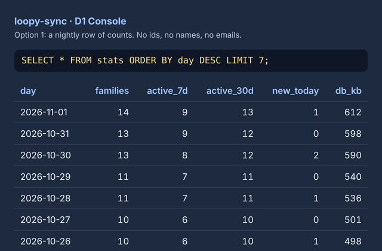
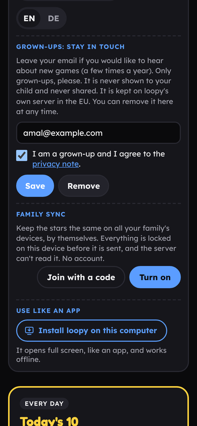
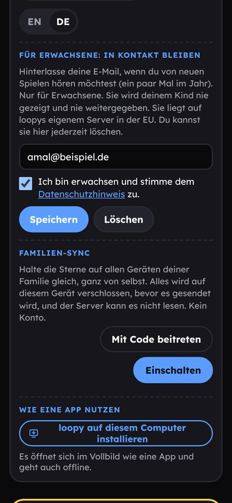
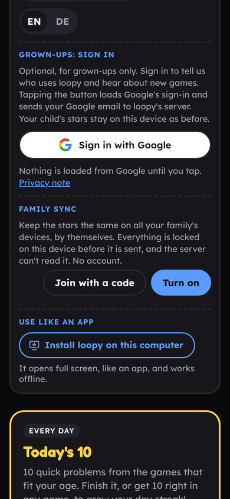
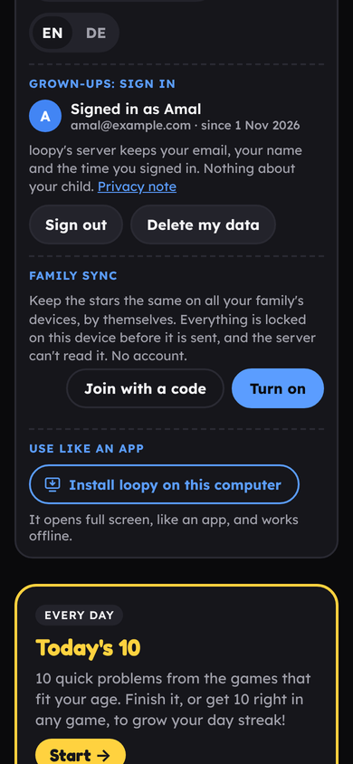
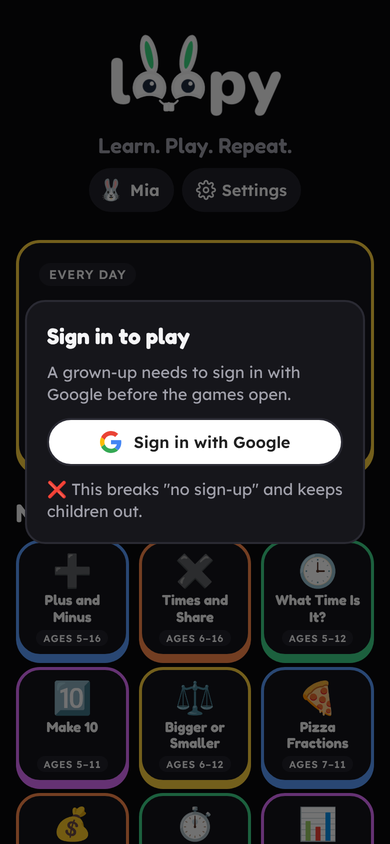

# Plan: Google sign-in and emails for tracking who uses loopy

The owner asked on 1 November 2026: add email with Google sign-in, store it in the Cloudflare Worker database, and use it to see and track who uses loopy. Picked: options 1 and 2 (issues #167, #168). Later: #169 (2b), #170 (3), #171 (4, parked).

This plan lays out four ways to do it, from "no change" to "sign in to play". No code has changed. Pick a number and I will build it.

## First, the plain facts

**What loopy promises today.** The home page, README, FAQ, Help page and guide all say: free, no sign-up, no accounts, no tracking, no analytics, "your browser only talks to loopy". The sync server (`sync/worker.js`, D1 table `families`) keeps only a random family id, two hashes, a locked copy and a time. It cannot tell who anyone is. That is written down in `sync/README.md` and in the sync-usage notes.

**An email is personal data.** Once loopy stores one, it has a name on a row. That is the point of your ask, and it is fine, but it means:

- The promise text in six places has to change (home, README, FAQ, Help, guide EN + DE, RELEASES). I can do that in the same PR.
- A privacy note is needed (GDPR, you are in Germany): who you are, what is stored, why, for how long, how to delete it. A short page in EN and DE, linked from Settings and the footer. Many German sites also need an Impressum. I am not a lawyer; this is the usual shape, please check it yourself.
- It must be grown-ups only. Children under 16 cannot consent in Germany, and Google accounts are 16+ there. So the box must say "grown-ups only" and must never be in a game.
- Every option below gives the person a **Delete** button that removes the row on the server, and the Worker keeps nothing else (no IP, no logs).
- The D1 database lives where Cloudflare put it. We can ask Cloudflare to keep the data in the EU with `location = "weur"` in `wrangler.toml`, but that only works for a new database. The `families` table would need a copy over. I would do the email table in a second, new EU database to keep it simple and leave `families` alone.

**Google needs an outside script.** "Sign in with Google" (Google Identity Services) loads `https://accounts.google.com/gsi/client`. loopy's rule is zero outside requests and a strict policy that lists only loopy's own files. So options 3 and 4 need:

- `tools/csp.py`: on the home page only, allow `script-src https://accounts.google.com`, `frame-src https://accounts.google.com`, and `connect-src https://accounts.google.com`. Every other page stays as it is.
- `tools/check_external.py`: one allowed exception for that address.
- The script is loaded only after a grown-up taps the button. So nothing goes to Google when a child opens loopy or plays. Google still gets the grown-up's IP address and sets cookies the moment the button is tapped. The privacy note has to say that.
- You make a Google Cloud project, an OAuth client id with `https://amalrajvinoth.github.io` as the allowed origin, and fill in the consent screen (app name "loopy", your email, the privacy note link). That is about 15 minutes in the Google Cloud console. I will give the exact steps. Google only asks for a review when you ask for more than email and name, which we do not.

**What "track and monitor" can mean.** Think about which one you want, because the options give different answers:

| You want to know | Option 1 | Option 2 | Option 3 | Option 4 |
| --- | --- | --- | --- | --- |
| How many families use loopy, and the trend | ✅ | ✅ | ✅ | ✅ |
| Who they are (an email you could write to) | ❌ | ✅ those who opt in | ✅ those who sign in | ✅ everyone |
| Which email belongs to which family copy | ❌ | ❌ (can be added, see 2b) | ❌ (can be added, see 3b) | ✅ |
| What a child did (stars, answers) | ❌ | ❌ | ❌ | ❌ still locked |

No option can show what a child does. The sync copy is locked on the device and that stays so.

## Option 1. Count families, no email (no promise changes) ✅ recommended for monitoring



This is option 4 from the sync-usage plan. The Worker's nightly job (it already runs at 03:17 to delete old copies) writes one row a day into a new `stats` table: date, families, active in 7 days, active in 30 days, new today, database size. You read it in the D1 Console, or I add a `GET /stats` so a tiny page can draw a line.

- What you get: the growth curve and activity over time. Not who.
- What changes: about 20 lines in `worker.js`, one `CREATE TABLE` in `schema.sql`, a test, a note in `sync/README.md`. No change on the site, no promise changes, no privacy note, nothing new is stored about anyone.
- Cost: one small PR, about an hour.

## Option 2. "Stay in touch": a grown-up types an email, no Google

 

A new part in ⚙ Settings on the home page, above Family sync: "Grown-ups: stay in touch". An email field, a tick box "I am a grown-up and I agree to the privacy note", Save and Remove. Saving sends `{ email, lang, time }` to the Worker, which stores it in a new table `grownups` in a new EU database. The browser keeps a small token so Remove works later.

- What you get: a list of grown-ups who want to hear from you, with the date they joined and their language. You can count them, see new ones per week, and write to them. It is also the honest shape of a "newsletter" sign-up, which is what most people expect an email box to be.
- Keeps: zero outside requests, the strict policy, nothing from Google. Only loopy's own Worker, which the pages already talk to.
- Changes: `sync/worker.js` gets `POST /g` (save) and `POST /g?del=1` (remove) with the same 10-second rate limit as sync; `schema.sql`; `src/loopy-sync.js` grows the Settings part (loaded only when Settings opens, so game pages stay as fast as now); strings EN + DE; privacy note page EN + DE; promise text in the six places; guide page "Stay in touch"; tests.
- Weak spot: nobody checks the email is real. Someone can type a wrong address. If you want to be sure, I can add a "we sent you a link, tap it" step later, but that needs a mail sender (Cloudflare has none for free; Resend or Mailchannels have free tiers). Also not many parents will fill it in. Expect a handful.
- Cost: one PR, about half a day.

**2b.** Tick box "Also link my email to our Family sync" writes the family id next to the email. Then you can see which family copy belongs to which parent. That is the one step that turns the anonymous `families` table into a named one for those who tick it. I would leave it out at first.

## Option 3. "Sign in with Google" for grown-ups, optional

 

Same place in Settings, but a Google button instead of a field. Tapping it loads Google's script, shows Google's own pop-up, and Google hands loopy a signed token with the email, name and picture. The home page sends the token to the Worker, the Worker checks the signature against Google's public keys (one fetch to `www.googleapis.com`, cached), and stores `{ sub, email, name, lang, time }` in table `grownups`. The page shows "Signed in as Amal", Sign out, and Delete my data.

- What you get: the same list as option 2, but every email is real and verified, no typing, and the person's name. Sign-in takes two taps for anyone already in Google on their phone.
- What breaks: the rule "zero outside requests" and "your browser only talks to loopy", on the home page, after a tap. The Settings text, FAQ, Help and guide must say "Google's sign-in loads when you tap the button and Google sees your IP address". The policy in `tools/csp.py` gets three Google entries for the home page. `check_external.py` gets one exception. Lighthouse's "best practices" score can drop a little on the home page because of the third-party script.
- What you do: Google Cloud project + OAuth client id + consent screen (steps in the PR). Add the client id to `src/loopy.js` like `Loopy.syncHost`.
- Changes: all of option 2, plus the Google loader (about 60 lines in `loopy-sync.js`, loaded on tap), token check in the Worker (about 40 lines, using Web Crypto, no library), the privacy note names Google as a third party.
- Cost: one PR, about a day, plus your 15 minutes in the Google console. iOS Safari blocks third-party cookies, so the pop-up flow is the one that works everywhere; the "One Tap" bar is not used.

**3b.** Same as 2b: link to the family id on request.

## Option 4. Sign in to play ❌ not recommended



Every device must sign in with Google before the games open, and the family id is always stored with the email. This gives the most complete "who uses it" answer. I do not recommend it:

- It ends "free, no sign-up, no tracking", which is on the poster, the WhatsApp invite, the README and the home page.
- A child without a grown-up nearby cannot play. A school tablet or a grandparent's phone cannot play.
- Under 16s cannot sign in with Google in Germany, so it is always a parent's account. That makes loopy a site that processes parents' data by default, which needs the full privacy setup from day one.
- Offline play (the service worker) and "Use like an app" get harder, because sign-in needs the network.

I list it only so the full range is clear.

## What every email option needs (2, 3, 4)

1. **Privacy note** page, EN + DE: `privacy/index.html` in loopy's style, linked from the new Settings part and the home footer pills. Says: who runs loopy (you), what is stored (email, name for Google, language, time, optional family id), why (to know who uses loopy and to tell you about new games), where (Cloudflare, EU), how long (until you delete it, or 2 years after the last sign-in), how to delete it (the button, or an email to you), and for option 3 that Google is a third party with its own privacy policy. A plain-English draft, you check it.
2. **Promise text** updated in: home page tagline area (no change needed if the words stay "no sign-up"; "no tracking" needs a "unless a grown-up signs up" clause), README "Privacy" part, FAQ q2, Help page q2 EN + DE, guide "Grown-ups" pages EN + DE, RELEASES row.
3. **Worker**: new table, new routes, rate limit, Delete route, nightly cleanup of rows older than 2 years, tests in `sync/test.mjs`, `sync/README.md` section.
4. **Settings part** in `src/loopy-sync.js` (not in `loopy.js`, so game pages do not grow), strings EN + DE, `Loopy.store` not used (this is device-wide, not per child, like language).
5. **Review**: loopy-review skill, `csp.py`, `check_external.py`, play test, a11y check, before/after pictures at 390x844.
6. **Issue** for roadmap #21.

## How you would read the data (2, 3, 4)

In the D1 Console, like today:

```sql
SELECT email, name, lang, datetime(t/1000,'unixepoch') AS joined FROM grownups ORDER BY t DESC;
SELECT COUNT(*) AS grownups, SUM(t > (strftime('%s','now')-7*86400)*1000) AS new_last_7_days FROM grownups;
```

Or a `GET /grownups` behind a secret token in `wrangler.toml`, so you can open it in a browser. I would start with the Console.

## Recommendation

- If the goal is to **see how many people use loopy and whether it grows**: build **option 1**. It answers that fully, changes no promise, and is the smallest PR. Say "Build option 1".
- If you also want **emails you can write to**: build **option 1 and option 2** together. No Google, no outside script, the strict policy stays, and the privacy note is short. Say "Build options 1 and 2".
- Build **option 3** only if real, verified Google emails matter more to you than the "nothing outside" rule. It works, and I have laid out what must change. Say "Build option 3".
- Please do not pick **option 4**.
