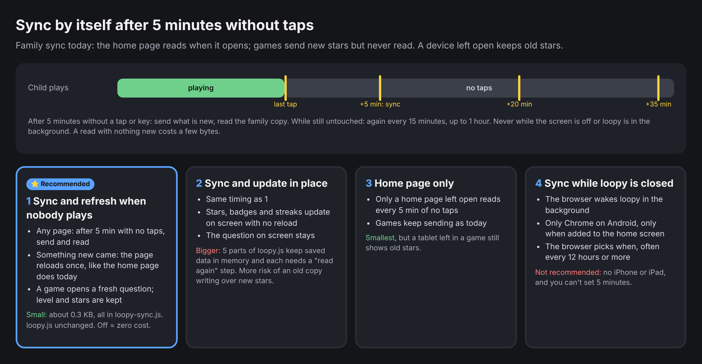

# Family sync by itself after 5 minutes without taps: options

Written 22 Oct 2026. Nothing has been changed in the repo yet.

## Where we are

Family sync (PR #132 and PR #133) is live.
- **Home page:** it reads the family copy when it opens, and again when you come back to it after a minute away. It reloads once if something new came.
- **Games:** they send new stars 20 seconds after a change (at most every 2 minutes) and when the game is left. They never read.
- **The gap:** a tablet left open on a game, or on the home page, keeps showing old stars. They update only when someone opens the home page again.

## The timing (same for options 1 to 3)

- "Inactive" means no tap, click or key for 5 minutes while loopy is on screen.
- At 5 minutes, loopy sends what is new and reads the family copy.
- While nobody touches it, it checks again every 15 minutes, for up to 1 hour. Then it stops until the next tap.
- It never checks while the screen is off or loopy is in the background.
- A read with nothing new costs a few bytes (the server answers "same as before").
- At most 5 requests per idle hour per device, so the free plan easily covers this.

## Options

1. **⭐ Sync and refresh when nobody plays.**
   - Any page reads after 5 idle minutes. If something new came, the page reloads once.
   - The home page already does this today. A game opens a fresh question, and the level and stars are kept.
   - The cost is about 0.3 KB, all in `loopy-sync.js`. `loopy.js` doesn't change, and a device with sync off pays nothing.
   - The one thing lost is the 🔥 streak on screen, after 5 minutes away.
2. **Sync and update in place.**
   - Same timing. Stars, badges and streaks change on screen with no reload.
   - This needs a "read again" step in 5 parts of `loopy.js` that keep saved data in memory (kids, stars, daily streak, answer log, Last 5). If one is missed, an old copy in memory can write over new stars.
   - It's bigger and riskier. It could come later.
3. **Home page only.** Only a home page left open checks after 5 idle minutes. It's the smallest change, but a tablet left in a game still shows old stars.
4. **Sync while loopy is closed** (Periodic Background Sync). This only works in Chrome on Android, after adding loopy to the home screen. The browser picks the time, often 12 hours or more, so 5 minutes can't be set. It doesn't work on iPhone or iPad. Not recommended.

## How we'd prove it

`tools/e2e/sync.mjs` gets new checks:
- After 5 idle minutes (with a fake clock), the other device's stars show.
- While the child keeps tapping, nothing reloads.
- With the page hidden, nothing is sent.
- With sync off, nothing changes at all.
