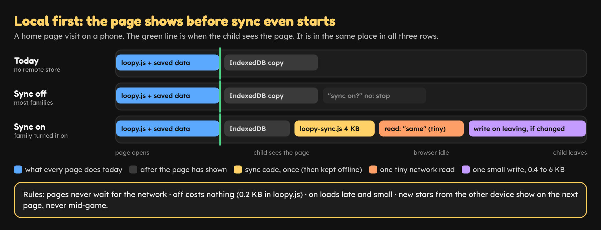
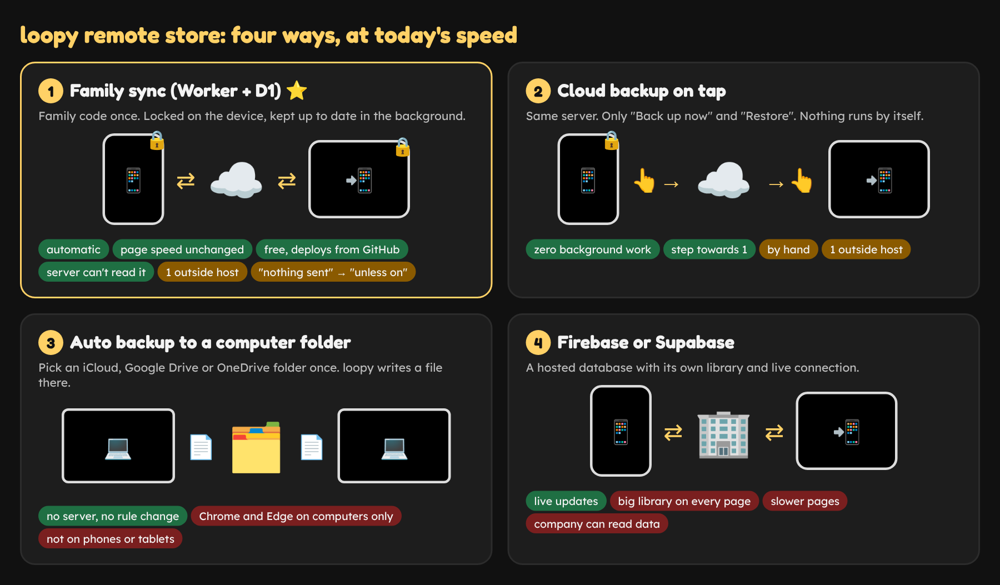

# Remote store for loopy, with no loss of speed: options

Written 22 Oct 2026. Nothing has been changed in the repo.

## The goal

Keep a copy of each child's stars and progress outside the browser, so they appear on the other device by themselves and survive a lost phone. Pages must open as fast as they do today.

## Where we are

- Every page reads its data from localStorage the moment it opens. Nothing waits for the network.
- `Loopy.keep` copies everything to IndexedDB after the page has loaded.
- Since PR #102 a grown-up can move stars with a QR code, the Send button or a backup file. All of this is by hand, and nothing is sent anywhere.
- Today, measured on main: `loopy.js` is 21.3 KB sent, the home page 17.3 KB, and `loopy-backup.js` 5.2 KB (it loads only when the stars box is opened). Lighthouse is 98 to 99 on a phone.

## The rule that keeps loopy fast: local first

Every option below follows the same five rules. They are what "no change in speed" means in practice.

1. **Pages never wait for the network.** They open from localStorage, exactly as today. The remote copy is read and written in the background.
2. **Off means zero cost.** A family that does not turn it on downloads nothing new and makes no request. `loopy.js` grows by about 0.2 KB, only for one check: "is sync on?".
3. **On means small and late.** The sync code is its own file (`loopy-sync.js`, about 4 KB sent). It loads after the page has shown, when the browser is idle. The offline helper keeps it, so it downloads once.
4. **Few, tiny requests.** One read when the home page opens, which costs almost nothing when nothing changed (an "ETag" lets the server answer "same as before" in a few bytes). One write when the child leaves a page, and only if something changed. The data is 0.4 to 6 KB.
5. **No surprises mid-game.** New stars from the other device are merged in the background and show on the next page, never by reloading the page the child is playing on.

## The options

### Option 1: Family sync on a free Cloudflare Worker with D1 ⭐ recommended

- **What changes:** Settings gets a "Family sync" part. A grown-up taps Turn on and gets a family code, like `MAPLE-TIGER-4821`, and a QR code. On the second device they scan it (the same QR code idea as PR #102) or type it. From then on, both devices keep each other up to date.
- **How it works:** loopy locks the stars code with the family code on the device (AES, built into every browser). A tiny Worker on Cloudflare keeps the locked copy in a D1 database, one row per family. The server cannot read it.
- **What you notice:** stars earned on the phone are on the tablet the next time it opens loopy. A lost phone loses nothing.
- **Speed:** no change when off. When on, about 4 KB once, then one tiny read per home page visit and one small write per session, all after the page has shown.
- **Existing tools:** the Worker is about 80 lines and lives in this repo. GitHub Actions deploys it with Cloudflare's `wrangler` tool on every push to main. The merge reuses `Loopy.backup`, which already only adds and never takes away. Old stars codes still load.
- **Free limits (checked 22 Oct 2026):** Workers 100,000 requests a day, D1 100,000 rows written and 5 million read a day, 5 GB stored. At about 20 requests per family per day, that covers roughly 5,000 families a day. KV is not used because its free plan allows only 1,000 writes a day.
- **Rules that change:** CSP `connect-src` adds one host (`loopy-sync.<account>.workers.dev`). `tools/check_external.py` allows that one host. "Nothing is sent anywhere" becomes "Nothing is sent anywhere unless a grown-up turns on Family sync. Then a locked copy goes to one server, which cannot read it." No sign-up: a family code is not an account.
- **Children's privacy:** the server sees a random family id, the time, the size of the locked copy and the device's IP address. It never sees names, stars or answers. Whoever has the family code can read the data, so loopy shows it only in Settings, behind ⚙.
- **Risk:** if the family code is lost on every device, the remote copy cannot be opened. The data on each device is still there.

### Option 2: Cloud backup on tap, same server, no automatic sync

- **What changes:** the same Worker and D1 as Option 1, but only two buttons: "Back up now" and "Restore". Nothing runs in the background.
- **What you notice:** a safe copy you control. Moving to a new device is: type the family code, tap Restore.
- **Speed:** no change at all. Nothing loads or runs until a grown-up taps a button.
- **Rules that change:** the same as Option 1.
- **Good for:** trying the server out first. Option 1 can be added later on the same server and data, with no migration.

### Option 3: Auto backup to a folder on a computer, no server

- **What changes:** on a computer, a grown-up picks a folder once, for example in iCloud Drive, Google Drive or OneDrive. loopy then writes `loopy-stars.json` there after each session and reads it when it opens. The computer's own cloud app carries the file to other computers.
- **Speed:** no change. No network request from loopy at all.
- **Rules that change:** none. Nothing is sent anywhere by loopy.
- **Limit:** only Chrome and Edge on Windows, Mac and Chromebook can do this. It does not work on iPhone, iPad, Android, Safari or Firefox, where most children play. The browser may ask again for permission on a later visit.

### Option 4: Firebase or Supabase (not recommended)

- **Why not, for speed:** their browser code is several times the size of all of `loopy.js`, and they open a live connection to several outside hosts. That would cost Lighthouse points on every page for every child, not only for families who use sync.
- **Why not, for privacy:** the company can read the data unless loopy locks it first, and the free plans can pause or change.

## Things that are the same in every option

- Local data stays the source of truth. A remote copy only adds, never takes away, through the same merge as a stars code.
- Old `LOOPY-` and `LOOPY2-` codes keep loading. The QR code, Send and backup file from PR #102 stay.
- Nothing remote is on by default. Children never see it.
- Offline play is unchanged. Sync waits until the device is online again.

## How we prove the speed did not change

- `tools/review.py` size budget: `loopy.js` may grow by at most 0.3 KB.
- A new play-test check: with sync off, no page makes any request to another host.
- With sync on: the home page shows before `loopy-sync.js` starts to load. The test records both times.
- Lighthouse on a phone, before and after, in the pull request.

## Recommendation

**Option 1**, built local first as above. It is the only option that syncs by itself on phones and tablets, stays free, lives in this repo, deploys from GitHub Actions and keeps the data unreadable to the server. Families who do not turn it on get exactly today's loopy.

If you would rather go one step at a time, start with **Option 2**. It uses the same server, so Option 1 can follow with no data change.

## If you pick Option 1 or 2, what the work looks like

1. `sync/worker.js` and `sync/wrangler.toml`: `GET /f/<id>` returns the locked copy with an ETag, `PUT /f/<id>` stores it (at most 200 KB, at most one write a minute per family). No list and no delete from the web.
2. `src/loopy-sync.js` (loads through `Loopy.load("sync")`): make or join a family, lock and unlock with WebCrypto, read and write in the background, merge with `Loopy.backup`.
3. A small check in `src/loopy.js` that loads it only when sync is on.
4. Settings: a "Family sync" part with Turn on, Join, the code and its QR code, and Turn off. English and German.
5. `tools/csp.py`, `tools/check_external.py`, Help, FAQ, README, DESIGN.md and RELEASES.md.
6. A GitHub Actions job that runs `wrangler deploy` on push to main.
7. **Steps for you:** make a free Cloudflare account, make an API token with "Workers Scripts: Edit" and "D1: Edit", and add it to the repo as the secret `CLOUDFLARE_API_TOKEN`. Claude gives the exact clicks when you pick.

## Sources

- [Cloudflare Workers limits](https://developers.cloudflare.com/workers/platform/limits/)
- [Cloudflare D1 pricing and free limits](https://developers.cloudflare.com/d1/platform/pricing/)
- [Cloudflare KV limits](https://developers.cloudflare.com/kv/platform/limits/)
